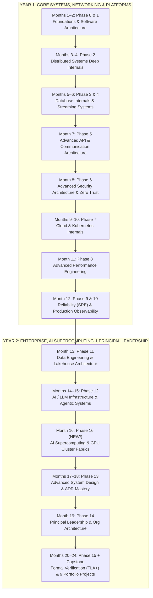

# Advanced Engineering Curriculum: Principal Engineer & Solution Architect Roadmap
> **లక్ష్యం:** సాధారణ Backend Developer స్థాయి నుంచి ప్రపంచస్థాయి Top Tech Engineering Organizations (Google, Meta, Amazon, Netflix, Uber, OpenAI) లో ఉపయోగించే **Principal Engineer / Enterprise Solution Architect** స్థాయికి చేరుకోవడం.

---

## 📌 Overview & Scope

ఈ curriculum కేవలం tools మరియు frameworks నేర్చుకోవడం కోసం కాదు.
మీరు ఒక distributed system ను మొదటి నుండి design చేయగలగాలి, systems internals & failure models ను లోతుగా అర్థం చేసుకోవాలి, microsecond-level latency bottlenecks పరిష్కరించాలి, మరియు complex architectural trade-offs ను senior engineering leadership ఎదుట సమర్థవంతంగా defend చేయగలగాలి.

| అంశం (Metric) | వివరాలు (Details) |
| :--- | :--- |
| **Duration** | 18–24 Months (15–20 hours/week) |
| **Major Domains** | **17 Major Learning Phases** (Phase 0 నుండి Phase 16 వరకు) |
| **New Phase Added** | ⭐ **Phase 16: AI Supercomputing, GPU Cluster Fabrics & Datacenter Accelerated Systems** |
| **Topics & Subtopics** | 120+ Advanced Architectural Topics & Deep Internals |
| **Major Portfolio Projects** | **9 Production-Grade Architectural Projects** (including AI Supercomputing Project) |
| **Learning Depth** | Fundamentals → Internals → Algorithms → Architecture → Implementation → Failure Analysis → Production Design |

---

## 🗺️ 18–24 Month Strategic Roadmap

---

## 📚 17 Learning Domains (All Phases)

| Phase | Domain | Core Focus | Link |
| :--- | :--- | :--- | :--- |
| **Phase 0** | **Engineering Foundations** | OS Architecture, Kernel/User Mode, Memory Models, MESI, TCP/QUIC Internals, Runtimes | [View Phase 0](phases/phase-00-engineering-foundations.md) |
| **Phase 1** | **Advanced Software Architecture** | Clean/Hexagonal Architecture, Strategic & Tactical DDD, Saga, Outbox, Cell-Based | [View Phase 1](phases/phase-01-advanced-software-architecture.md) |
| **Phase 2** | **Distributed Systems: Deep Internals** | Raft/Paxos Consensus, Logical Clocks (HLC), CRDTs, Split-Brain, Linearizability, 2PC/3PC | [View Phase 2](phases/phase-02-distributed-systems.md) |
| **Phase 3** | **Advanced Database Engineering** | Storage Engines (B+ Tree, LSM), MVCC, SSI, Distributed SQL, Distributed Joins, Spanner | [View Phase 3](phases/phase-03-advanced-database-engineering.md) |
| **Phase 4** | **Messaging & Streaming Systems** | Kafka Internals (ISR, Zero-Copy), Flink Stream Processing, Watermarks, Exactly-Once | [View Phase 4](phases/phase-04-messaging-and-streaming.md) |
| **Phase 5** | **API & Communication Architecture** | gRPC, GraphQL Federation, HTTP/3 QUIC, Rate Limiting (Token Bucket), Request Hedging | [View Phase 5](phases/phase-05-api-and-communication.md) |
| **Phase 6** | **Advanced Security Architecture** | Zero Trust, OAuth 2.1/OIDC, SPIFFE/SPIRE, Zanzibar ReBAC, Post-Quantum Crypto | [View Phase 6](phases/phase-06-advanced-security.md) |
| **Phase 7** | **Cloud & Infrastructure Engineering** | Multi-Region VPC, Kubernetes Internals (CRI/CNI/CSI/Operators), eBPF Cilium, GitOps | [View Phase 7](phases/phase-07-cloud-and-infrastructure.md) |
| **Phase 8** | **Advanced Performance Engineering** | Tail Latency (P99.9), Coordinated Omission, io_uring, Kernel Bypass (DPDK), NUMA | [View Phase 8](phases/phase-08-performance-engineering.md) |
| **Phase 9** | **Reliability & Resilience Engineering** | SRE SLI/SLO/Error Budgets, Chaos Engineering, Active-Active Multi-Region, RTO/RPO | [View Phase 9](phases/phase-09-reliability-and-resilience.md) |
| **Phase 10** | **Observability & Production Intelligence** | OpenTelemetry, Distributed Tracing Context Propagation, Continuous Profiling | [View Phase 10](phases/phase-10-observability-and-intelligence.md) |
| **Phase 11** | **Data Engineering & Lakehouse** | Medallion Architecture, Apache Iceberg, Spark/Flink Internals, Data Mesh, Trino | [View Phase 11](phases/phase-11-data-engineering-and-analytics.md) |
| **Phase 12** | **AI / LLM Infrastructure** | Transformer Internals, PagedAttention/vLLM, Multi-Agent MCP, Guardrails, LoRA | [View Phase 12](phases/phase-12-ai-and-llm-infrastructure.md) |
| **Phase 13** | **System Design & Decision Making** | 15 Real-World Enterprise Systems, Capacity Estimation, ADRs, ATAM Trade-offs | [View Phase 13](phases/phase-13-system-design-and-decisions.md) |
| **Phase 14** | **Principal Leadership & Org Architecture** | Conway's Law, Team Topologies, FinOps Economics, Architecture Governance | [View Phase 14](phases/phase-14-technical-leadership-and-org.md) |
| **Phase 15** | **Research & Emerging Engineering** | Formal Methods (TLA+), Confidential Computing, Jepsen Testing, Disaggregated HW | [View Phase 15](phases/phase-15-research-and-emerging-engineering.md) |
| **Phase 16** | ⭐ **AI Supercomputing & GPU Cluster Fabrics** *(NEW)* | InfiniBand vs RoCEv2, NCCL Collective Comm, GPU Schedulers (Slurm/Kueue), Storage | [View Phase 16](phases/phase-16-ai-supercomputing-and-gpu-clusters.md) |

---

## 🛠️ 9 Major Portfolio Projects

ఈ 9 ప్రాజెక్టులు మీ practical engineering credibility ని demonstrate చేయడానికి concrete evidence గా పనిచేస్తాయి:

1. [**Distributed Key-Value Database**](projects/01-distributed-key-value-store.md): Raft consensus, log compaction, snapshotting, virtual nodes sharding, and network partition recovery.
2. [**Enterprise Microservices Platform**](projects/02-enterprise-microservices-platform.md): Modular architecture, Saga orchestrator, Transactional Outbox, Envoy service mesh, and mTLS.
3. [**Mini Database Storage Engine**](projects/03-mini-database-storage-engine.md): Write-Ahead Log (WAL), B+ Tree / LSM Tree index, MemTable, SSTable compaction, and MVCC recovery.
4. [**Real-Time Event Processing Platform**](projects/04-realtime-event-processing-platform.md): Kafka + Apache Flink streaming pipeline with tumbling/sliding windows, out-of-order event handling, and exactly-once state.
5. [**Zero Trust Identity & Access Platform**](projects/05-zero-trust-identity-platform.md): Keycloak OIDC, SPIFFE/SPIRE workload identities, Open Policy Agent (OPA) fine-grained authorization, and mutual TLS.
6. [**Kubernetes Internal Developer Platform (IDP)**](projects/06-internal-developer-platform.md): Custom Kubernetes Operator, ArgoCD GitOps engine, golden paths, policy-as-code, and ephemeral preview environments.
7. [**Production Observability Platform**](projects/07-production-observability-platform.md): OpenTelemetry collector pipelines, distributed tracing context propagation across async workers, continuous profiling, and SLO alerting.
8. [**Enterprise Multi-Tenant AI Platform**](projects/08-enterprise-ai-platform.md): Hybrid GraphRAG, Agentic tool execution (MCP protocol), dynamic model gateway with semantic caching, and guardrail verification.
9. ⭐ [**AI Supercomputing Cluster & Distributed Training Platform**](projects/09-ai-supercomputer-distributed-training-platform.md) *(NEW)*: Slurm/Kueue GPU scheduler, RoCE/NCCL collective communication simulator, asynchronous distributed checkpointing, and GPU fault-tolerance engine.

---

## 🔬 ప్రతి Topic కి 10-Step Deep-Dive Learning Framework

ఒక్కో concept నేర్చుకునేటప్పుడు ఈ 10 దశల methodology ని తప్పనిసరిగా అనుసరించాలి:

```mermaid
flowchart LR
    S1["1. What & Why"] --> S2["2. Fundamentals"]
    S2 --> S3["3. Internals"]
    S3 --> S4["4. Algorithms"]
    S4 --> S5["5. Architecture"]
    S5 --> S6["6. Implementation"]
    S6 --> S7["7. Failure Scenarios"]
    S7 --> S8["8. Trade-offs"]
    S8 --> S9["9. Production Hardening"]
    S9 --> S10["10. Architecture Defense"]
```

1. **What & Why:** ఈ technology లేదా pattern అసలు ఎందుకు కనిపెట్టబడింది? ఇది పరిష్కరించే అసలు సమస్య ఏమిటి?
2. **Fundamentals:** Core underlying computer science principles (OS, memory, network, concurrency).
3. **Internals:** బ్లాక్ బాక్స్ లోపల నిజంగా ఏం జరుగుతోంది? (Memory allocations, buffers, system calls, packets).
4. **Algorithms:** Mathematical formulations, consensus rounds, hash functions, or queue algorithms.
5. **Architecture:** High-level components, network topologies, data pipelines, and interaction flows.
6. **Implementation:** చేతులతో code రాయడం (Scratch implementation or production-grade integration).
7. **Failure Scenarios:** నెట్‌వర్క్ తెగిపోతే, నోడ్ క్రాష్ అయితే, క్లాక్ స్కివ్ వస్తే, డిస్క్ కరప్ట్ అయితే ఏం జరుగుతుంది?
8. **Trade-offs:** CAP Theorem, PACELC, Latency vs Consistency, Cost vs Complexity విశ్లేషణ.
9. **Production Hardening:** Production deployment లో metric thresholds, autoscaling, security, backup strategies.
10. **Architecture Defense (Interview & Review):** ADR (Architecture Decision Record) రాసి, ఇతర Senior Architects అడిగే కఠిన ప్రశ్నలకు సమాధానాలు డిఫెండ్ చేయడం.

---

## 🎯 ప్రతి Phase కి Completion Criteria

ఒక Phase పూర్తయిందని నిర్ధారించుకోవడానికి క్రింది checklist ను పూర్తి చేయాలి:
- [ ] ఆ Phase లోని అన్ని listed topics ను క్షుణ్ణంగా అర్థం చేసుకోవడం.
- [ ] Core algorithms & failure models ను diagram తో వివరించగలగడం.
- [ ] పేర్కొన్న practical project / implementation ను స్వయంగా పూర్తి చేయడం.
- [ ] కనీసం 3 వాస్తవ failure scenarios (Network partition, memory leak, cascading failure) ను simulate చేసి పరిష్కరించడం.
- [ ] ఆ Phase లోని key architectural choice పై ఒక పూర్తి స్థాయి **Architecture Decision Record (ADR)** డాక్యుమెంట్ చేయడం.
- [ ] Quantitative trade-offs (Latency, Throughput, Cost, Availability) ను నిరూపించడం.
- [ ] కనీసం ఒక Enterprise Real-World System Design Scenario ను Whiteboard/Design Doc రూపంలో వివరించడం.

---

## 🧰 Target Technology Stack Matrix

| Category | Primary Technologies | Target Architecture Knowledge |
| :--- | :--- | :--- |
| **Languages** | Go, Rust, Java, Python | Memory layouts, Concurrency primitives, Async runtimes, GC tuning |
| **Databases (OLTP & NewSQL)** | PostgreSQL, CockroachDB, YugabyteDB, Cassandra | MVCC, SSI, Distributed Transactions, LSM/B+ Trees, Raft storage |
| **In-Memory & Caching** | Redis, Dragonfly | Event loop, memory allocator, eviction algorithms, cluster gossip |
| **Messaging & Streaming** | Apache Kafka, Apache Flink, RabbitMQ | Commit logs, ISR replication, Watermarking, Exactly-Once, RocksDB state |
| **Networking & APIs** | Envoy, gRPC, Protobuf, GraphQL, HTTP/3 | Zero-copy, multiplexing, backpressure, connection pools |
| **Cloud & Containers** | Kubernetes, Docker, Cilium (eBPF), Istio | Cgroups, Namespaces, CRI/CNI/CSI, Service Mesh mTLS, eBPF routing |
| **Security & Identity** | Keycloak, SPIFFE/SPIRE, OPA/Cedar, Vault | OIDC/OAuth2.1, Workload Identity, ReBAC (Zanzibar), Envelope Encryption |
| **Observability** | OpenTelemetry, Prometheus, Grafana, Tempo, Pyroscope | Context propagation, RED/USE metrics, Distributed flame graphs |
| **Data Engineering** | Apache Iceberg, Spark, DuckDB, Trino | Parquet columnar encoding, Medallion Lakehouse, Distributed query plans |
| **AI Infrastructure** | vLLM, PyTorch, LangGraph, Qdrant/Milvus, MCP | PagedAttention, KV cache, Continuous batching, Agent tool orchestration |
| **AI Supercomputing (Phase 16)** | Slurm, RoCEv2/InfiniBand, NCCL, Lustre/DAOS | RDMA fabrics, Fat-Tree topologies, All-Reduce ring/tree, GPU scheduling |
| **Formal Methods** | TLA+, PlusCal | State-machine verification, temporal logic, safety & liveness invariant checking |

---

## 📁 Repository Navigation

- **Phases Directory:** [`phases/`](phases/)
- **Projects Directory:** [`projects/`](projects/)
- **Templates Directory:** [`templates/`](templates/)
- **Progress Tracker:** [`progress-tracker.md`](progress-tracker.md)
