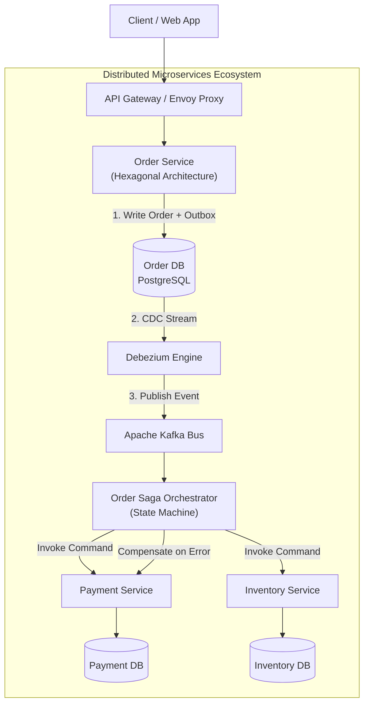

# Project 02 — Enterprise Microservices Platform with Saga & Outbox
> **Phase Alignment:** [Phase 1 — Advanced Software Architecture](../phases/phase-01-advanced-software-architecture.md)  
> **Target Complexity:** Staff / Principal Enterprise Architect  
> **Recommended Languages:** Java (Spring Boot), Go, TypeScript / Node.js

---

## 🎯 Project Overview
Build a resilient, production-grade microservices platform for high-value financial or e-commerce transactions. The platform demonstrates how to maintain transactional consistency across distributed services without distributed 2PC locks, using the **Orchestrated Saga Pattern**, **Transactional Outbox Pattern**, and **Envoy Service Mesh**.

---

## 🏗️ Architecture & Component Design

---

## 📋 Core Architectural Requirements

1. **Clean & Hexagonal Architecture:** Domain logic must remain completely decoupled from transport frameworks and database drivers via Ports and Adapters.
2. **Transactional Outbox Pattern:**
   - Write business state updates and outgoing domain events atomically into the same database transaction.
   - Use Debezium or an asynchronous polling worker to guarantee at-least-once publishing to Kafka.
3. **Saga Orchestrator State Machine:**
   - Orchestrate long-running multi-step transactions: `CreateOrder` $\rightarrow$ `AuthorizePayment` $\rightarrow$ `ReserveInventory` $\rightarrow$ `DispatchShipping`.
   - Maintain saga execution logs and handle step timeouts.
   - Automatic execution of **Compensating Transactions** when downstream steps fail (e.g., refund payment if inventory reservation fails).
4. **Idempotent Consumers:** Implement the Transactional Inbox pattern with deduplication keys to safeguard against duplicated Kafka messages.
5. **Resilience & Fault Isolation:** Circuit breaker, rate limiting, and bulkhead policies on all inter-service HTTP/gRPC clients.

---

## 🧪 Verification & Acceptance Criteria
- Trigger simulated inventory exhaustion during an active checkout and verify that the payment is automatically reversed via a compensating transaction within 2 seconds.
- Kill the message broker mid-transaction; verify that when restarted, the outbox worker recovers seamlessly without dropped or duplicated orders.
