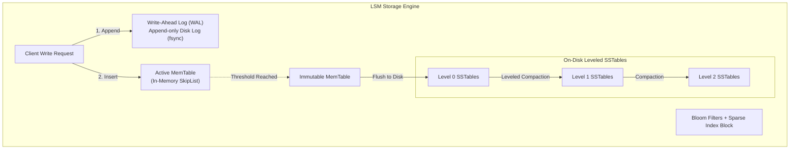

# Project 03 — Mini Database Storage Engine (LSM-Tree & WAL)
> **Phase Alignment:** [Phase 3 — Advanced Database Engineering](../phases/phase-03-advanced-database-engineering.md)  
> **Target Complexity:** Senior / Staff / Principal Database Systems Engineer  
> **Recommended Languages:** Rust, C++, Go

---

## 🎯 Project Overview
Implement a high-performance, embedded log-structured merge-tree (LSM-Tree) storage engine inspired by RocksDB and LevelDB from scratch. The engine must support atomic durable writes via a Write-Ahead Log (WAL), fast in-memory lookups via an immutable SkipList MemTable, tiered disk SSTable flushes with Bloom filters, multi-version concurrency control (MVCC), and background leveled compaction.

---

## 🏗️ Architecture & Component Design

---

## 📋 Core Architectural Requirements

1. **Write-Ahead Log (WAL):**
   - Append-only binary format with CRC32 checksum per record.
   - Configurable `fsync` flushing policy (synchronous per write vs batched interval).
2. **MemTable:** Concurrent SkipList or lock-free skip list supporting `Put`, `Get`, `Delete` (tombstone markers), and range scans (`Iterator`).
3. **SSTable (Sorted String Table) Format:**
   - Block-based format: Data blocks (4KB each), Index block (sparse key pointers), and Bloom filter block.
   - Fixed-size block trailers with compression (Snappy / LZ4 optional).
4. **Leveled Compaction Worker:**
   - Background thread monitoring SSTable count and size across levels.
   - Merging overlapping key ranges, purging shadowed old versions, and discarding deleted tombstones.
5. **Crash Recovery & MVCC:**
   - Immediate replay of WAL on startup to restore in-memory state after an ungraceful shutdown.
   - Snapshot reading support: Reads at timestamp $T$ only see versions committed prior to $T$.

---

## 🧪 Verification & Acceptance Criteria
- Run a benchmark inserting 5,000,000 keys; verify steady write throughput without memory exhaustion.
- Pull the power cord simulation (`SIGKILL` during active flush); verify zero corruption and 100% data recovery on next boot via WAL replay.
