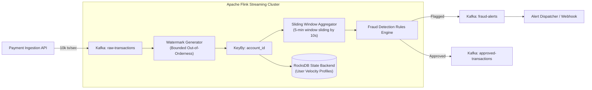

# Project 04 — Real-Time Event Processing & Fraud Detection Platform
> **Phase Alignment:** [Phase 4 — Messaging & Streaming Systems](../phases/phase-04-messaging-and-streaming.md)  
> **Target Complexity:** Staff / Principal Data & Streaming Architect  
> **Recommended Technologies:** Apache Kafka, Apache Flink, Java / Scala / Python, Redis

---

## 🎯 Project Overview
Build an ultra-reliable, stateful event streaming engine designed to detect payment fraud and anomalous user behaviors across millions of concurrent banking events. The pipeline leverages **Apache Kafka** partitioned logs, **Apache Flink** event-time processing with sliding windows, and RocksDB state backends with checkpointing for exactly-once processing guarantees.

---

## 🏗️ Architecture & Component Design

---

## 📋 Core Architectural Requirements

1. **High-Throughput Ingestion:**
   - Multi-partition Kafka topic partitioned deterministically by `account_id` or `card_hash`.
   - Idempotent producer configuration with `acks=all` and compression enabled.
2. **Event-Time Semantics & Watermarking:**
   - Ingestion handles network delays and out-of-order event arrivals with a bounded out-of-orderness watermark generator (e.g., 5-second lag tolerance).
   - Late-arriving events redirected to a dedicated side-output stream.
3. **Stateful Windowing & Rules Engine:**
   - Compute real-time transaction velocity, total spend, and distinct geographic locations in a 5-minute sliding window.
   - Detect suspicious velocity jumps (e.g., $>3$ distinct IP countries in $<5$ minutes, or $>500\%$ expenditure surge).
4. **State Management & Checkpointing:**
   - Flink RocksDB state backend with incremental checkpointing to S3/MinIO.
   - Exactly-Once Semantics (EOS) enabled end-to-end using Flink's Two-Phase Commit Kafka Sink.

---

## 🧪 Verification & Acceptance Criteria
- Inject 1,000,000 simulated transactions with 10% out-of-order arrival timestamps; verify that 100% of generated watermarks correctly trigger sliding window calculations without data dropping.
- Force kill a Flink TaskManager worker mid-computation; verify that Flink automatically restarts from the last checkpoint with exactly-once counts verified against ground truth.
