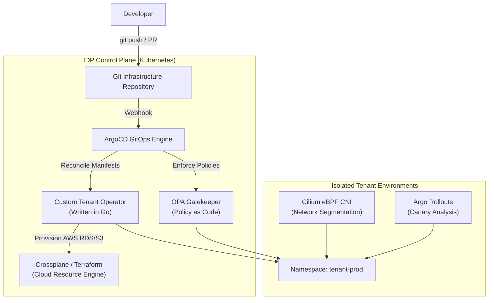

# Project 06 — Kubernetes Internal Developer Platform (IDP)
> **Phase Alignment:** [Phase 7 — Advanced Cloud & Infrastructure](../phases/phase-07-cloud-and-infrastructure.md)  
> **Target Complexity:** Staff / Principal Platform Architect  
> **Recommended Technologies:** Kubernetes, Go (Operator SDK), ArgoCD, Terraform, Cilium, Crossplane

---

## 🎯 Project Overview
Design and build a self-service **Internal Developer Platform (IDP)** that abstracts complex cloud and Kubernetes infrastructure behind a unified developer interface. The platform delivers automated multi-tenant environment provisioning, GitOps-based progressive delivery with canary rollouts, policy enforcement, and infrastructure-as-code automation.

---

## 🏗️ Architecture & Component Design

---

## 📋 Core Architectural Requirements

1. **Custom Tenant Operator (Kubebuilder / Go):**
   - Create a Custom Resource Definition (CRD): `TenantEnvironment`.
   - The reconciliation loop automatically provisions: isolated namespace, Cilium `NetworkPolicy` rules, `ResourceQuota`, `LimitRange`, HashiCorp Vault service account bindings, and default ingress routes.
2. **GitOps Engine (ArgoCD):**
   - Full declarative state synchronization with automated drift detection and self-healing.
   - Branch-based dynamic preview environments spun up automatically on pull request creation and destroyed upon merge.
3. **Progressive Delivery & Canary Rollouts:**
   - Deploy workloads using **Argo Rollouts** with step-based canary traffic shifting (10% $\rightarrow$ 25% $\rightarrow$ 50% $\rightarrow$ 100%).
   - Automated rollback triggered if Prometheus reports error rate $>0.5\%$ or P99 latency $>300$ms.
4. **Cloud Infrastructure Orchestration (Crossplane / Terraform):**
   - Developers request cloud databases (e.g., PostgreSQL RDS) and storage buckets via Kubernetes YAML without touching the AWS/GCP console directly.
5. **Security & Guardrails:**
   - OPA Gatekeeper / Kyverno policies forbidding privileged containers, enforcing read-only root filesystems, and requiring mandatory resource limits.

---

## 🧪 Verification & Acceptance Criteria
- Open a Pull Request in an application repository; verify that an ephemeral preview environment is deployed, DNS registered, and accessible within 90 seconds.
- Trigger an application deployment that injects an intentional 500 error; verify that Argo Rollouts detects metric failure at the 10% canary stage and completes a clean automated rollback without impacting primary production traffic.
