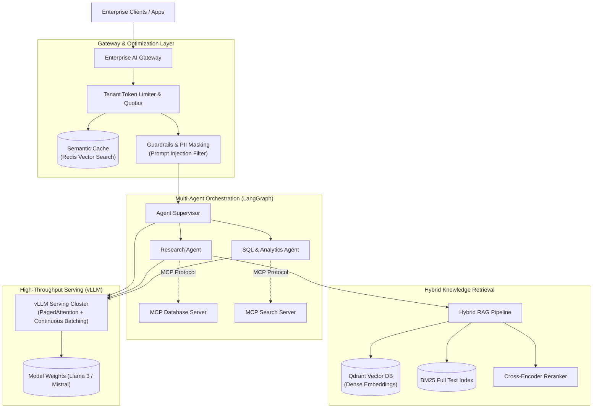

# Project 08 — Enterprise Multi-Tenant AI Platform (RAG, Agents & Gateway)
> **Phase Alignment:** [Phase 12 — Advanced AI / LLM Infrastructure](../phases/phase-12-ai-and-llm-infrastructure.md)  
> **Target Complexity:** Staff / Principal AI & Distributed Systems Architect  
> **Recommended Technologies:** Python, vLLM, LangGraph, Model Context Protocol (MCP), Qdrant, Redis

---

## 🎯 Project Overview
Build a production-grade, secure, multi-tenant enterprise Generative AI platform. The system features a unified AI Gateway with semantic caching and token rate limiting, high-throughput model serving via **vLLM PagedAttention**, a hybrid vector/graph RAG pipeline, and autonomous multi-agent orchestration communicating via the **Model Context Protocol (MCP)**.

---

## 🏗️ Architecture & Component Design

---

## 📋 Core Architectural Requirements

1. **Intelligent AI Gateway:**
   - Multi-tenant API key authentication with per-tenant tokens-per-minute (TPM) and requests-per-minute (RPM) quotas.
   - **Semantic Caching:** Query Redis vector index with embedding similarity ($>0.96$ cosine similarity); return cached completions for identical intent, reducing LLM costs by up to 40%.
   - Prompt guardrails: Detecting jailbreak attempts, sanitizing prompt injections, and masking PII.
2. **High-Performance Foundation Model Serving (vLLM):**
   - Deploy open foundation models (e.g., Llama 3 8B/70B) with continuous batching and PagedAttention.
   - Dynamic speculative decoding and streaming response generation over Server-Sent Events (SSE).
3. **Advanced Hybrid RAG Pipeline:**
   - Document chunking with semantic boundaries.
   - Dense vector retrieval (Qdrant) combined with sparse BM25 retrieval using Reciprocal Rank Fusion (RRF).
   - Precision reranking using a Cross-Encoder before context window assembly.
4. **Agentic System with Model Context Protocol (MCP):**
   - Multi-agent workflow orchestrated with **LangGraph** (Supervisor, Researcher, Coder).
   - Decouple agent tool execution using **MCP Servers** exposing external databases, APIs, and file systems over standard JSON-RPC.
   - Persistent agent state checkpoints and human-in-the-loop review hooks for high-risk actions.
5. **Continuous Evaluation:**
   - Automated offline pipeline evaluating retrieval faithfulness, answer relevance, and hallucination rates via RAGAS.

---

## 🧪 Verification & Acceptance Criteria
- Submit 100 concurrent complex reasoning queries; verify that vLLM continuous batching maintains sub-50ms Time-To-First-Token (TTFT) and high token generation throughput.
- Demonstrate that the MCP Supervisor agent successfully delegates a multi-step query, invokes external database tools via MCP, and synthesizes a verified answer with zero hallucinated tool parameters.
