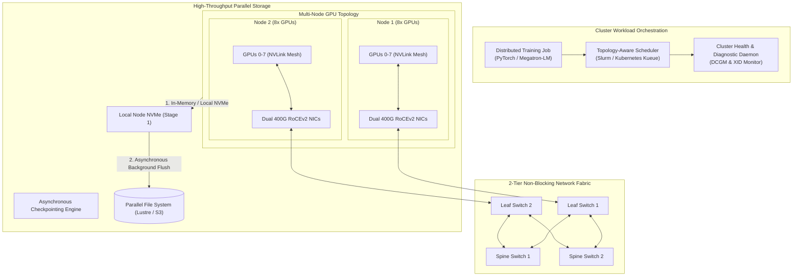

# Project 09 — AI Supercomputing Cluster & Interconnect Resilience Platform
> **Phase Alignment:** [Phase 16 — AI Supercomputing, GPU Cluster Fabrics & Datacenter-Scale Accelerated Systems](../phases/phase-16-ai-supercomputing-and-gpu-clusters.md)  
> **Target Complexity:** Principal Infrastructure Architect / HPC Systems Engineer  
> **Recommended Technologies:** Python, C++, Slurm Simulator / Kubernetes Kueue, PyTorch Distributed, RoCEv2/NCCL Simulator

---

## 🎯 Project Overview
Design and build a simulated **Multi-Node AI Supercomputing Fabric & Distributed Training Orchestrator**. The project models a cluster of 512–2,048 GPUs interconnected across a 2-tier Non-Blocking Fat-Tree network fabric. It simulates collective communication algorithms (Ring All-Reduce, Tree All-Reduce), measures network incast and Priority Flow Control (PFC) deadlocks, implements asynchronous checkpointing, and provides automated GPU failure recovery to maximize Model FLOPs Utilization (MFU).

---

## 🏗️ Architecture & Component Design

---

## 📋 Core Architectural Requirements

1. **Topology-Aware GPU Cluster Scheduler:**
   - Implement an intelligent scheduling engine (inspired by Slurm and Kubernetes Kueue) that assigns multi-GPU jobs to compute nodes sharing the same physical leaf switch to minimize spine hops.
   - Enforce gang scheduling: All required workers must be allocated simultaneously, or the job stays queued.
2. **Collective Communication & Network Fabric Simulator:**
   - Simulate **Ring All-Reduce** and **Tree All-Reduce** gradient synchronization across multi-node topologies.
   - Model network congestion: Simulate RoCEv2 Priority Flow Control (PFC) pause frames, Explicit Congestion Notification (ECN) marking, and queue buffer overflow.
   - Quantify the impact of packet drops and link flapping on total training iteration time.
3. **Asynchronous Non-Blocking Checkpointing Engine:**
   - Eliminate synchronous checkpoint stalls (where 500GB+ model state halts GPU training for minutes).
   - Implement a staged checkpointing pipeline: Copy GPU VRAM state to host pinned memory / local NVMe SSD in $<2$ seconds, then stream asynchronously to distributed storage in the background while GPUs immediately resume forward/backward training passes.
4. **Resilience & Fault Recovery (Self-Healing AI Infrastructure):**
   - Monitor simulated hardware events: NVIDIA DCGM metrics, XID 79 errors (GPU falling off PCIe bus), and thermal throttling.
   - Implement dynamic node replacement with PyTorch Elastic (TorchElastic): Automatically isolate the failing node, launch a standby healthy node, restore the latest asynchronous checkpoint, and resume training with $<3$ minutes of downtime.
5. **AI FinOps & Efficiency Metrics Engine:**
   - Calculate real-time **Model FLOPs Utilization (MFU)** and Hardware FLOPs Utilization (HFU).
   - Visualize GPU idle bubbles caused by network stragglers and compute cost wasted during restarts.

---

## 🧪 Verification & Acceptance Criteria
- Run a benchmark comparing Ring All-Reduce vs Hierarchical Tree All-Reduce across a simulated 64-node cluster; prove that hierarchical communication reduces inter-switch traffic by $>60\%$.
- Inject an unrecoverable GPU failure on Node 14 mid-training run; verify that the platform automatically drains the node, provisions a spare node, restores checkpoint state, and resumes training with zero manual intervention.
- Demonstrate that asynchronous checkpointing achieves $>95\%$ Model FLOPs Utilization (MFU) compared to $<70\%$ MFU for synchronous checkpointing.
