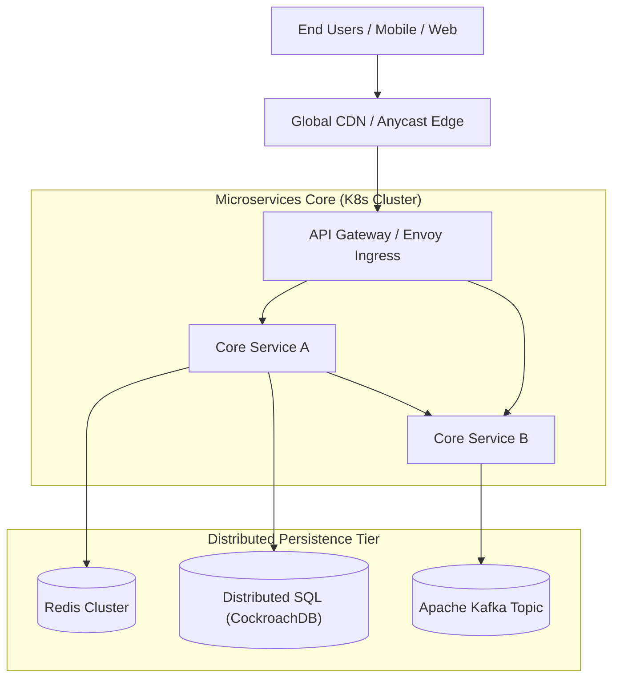

# Enterprise System Architecture RFC / Design Document Template

# System Architecture RFC: [System Name]

- **Document Status:** [Draft | In Review | Approved | Implemented]
- **Author:** [Principal Engineer / Solution Architect]
- **Target Implementation Date:** QX YYYY
- **Target Audience:** Engineering Leads, Architecture Review Board (ARB), Staff+ Engineers

---

## 1. Executive Summary & Problem Definition
*Provide a concise 1–2 paragraph overview of the system being designed, its business justification, and primary technical objective.*

---

## 2. Requirements & Scope Boundaries

### 2.1 Functional Requirements (In Scope)
- [ ] FR-1: Users can perform action X with guaranteed idempotent outcome.
- [ ] FR-2: System automatically synchronizes state changes to downstream listeners via event stream.
- [ ] FR-3: Multi-tenant tenant boundary isolation with dedicated encryption keys.

### 2.2 Out of Scope
- What is explicitly *not* being addressed in this phase?

### 2.3 Non-Functional Requirements (Quality Attributes)
- **Throughput:** [e.g., 50,000 writes/sec peak; 200,000 reads/sec peak]
- **Latency SLA:** [e.g., P99 $< 25$ms for reads; P99 $< 60$ms for writes]
- **Availability:** [e.g., 99.99% availability (max 52 minutes unplanned downtime/year)]
- **Durability & Consistency:** [e.g., Zero data loss (RPO = 0), Linearizable read/write consistency]
- **Disaster Recovery:** [e.g., Multi-region failover with RTO $< 30$ seconds]
- **Security & Compliance:** [e.g., SOC2 Type II, HIPAA, PCI-DSS Level 1, Zero Trust mTLS]

---

## 3. Capacity Math & Hardware Sizing

### 3.1 Traffic Estimates
- Daily Active Users (DAU): `X Million`
- Read/Write Ratio: `Y : Z`
- Average Queries Per Second (QPS): $\frac{DAU \times actions}{86,400} = \text{QPS}$
- Peak QPS ($3\times$ Multiplier): `Peak QPS`

### 3.2 Storage Estimates
- Average payload size per record: `A KB`
- Daily storage ingestion: $\text{Daily Writes} \times \text{Payload Size} = \text{GB/day}$
- 3-Year Retention with $3\times$ Replication: `Total Terabytes`

### 3.3 Network Bandwidth & RAM
- Ingress Bandwidth: `MB/sec`
- Egress Bandwidth: `MB/sec`
- Hot Cache RAM Requirement (80/20 Rule for 1-day hot data): `GB of RAM`

---

## 4. High-Level Architecture (C4 Model Context & Containers)



---

## 5. Low-Level Component Design & API Contracts

### 5.1 Public & Internal API Specifications
```protobuf
// Sample Protobuf / gRPC Interface
syntax = "proto3";
package enterprise.system.v1;

service TransactionService {
  rpc ExecuteTransaction (TransactionRequest) returns (TransactionResponse);
}

message TransactionRequest {
  string idempotency_key = 1;
  string account_id = 2;
  int64 amount_cents = 3;
}
```

### 5.2 Database Schema & Partitioning Key Strategy
```sql
-- Core Ledger Table Design
CREATE TABLE accounts_ledger (
    account_id UUID NOT NULL,
    transaction_id UUID NOT NULL,
    amount_cents BIGINT NOT NULL,
    balance_after BIGINT NOT NULL,
    created_at TIMESTAMPTZ NOT NULL DEFAULT NOW(),
    PRIMARY KEY (account_id, created_at, transaction_id)
) PARTITION BY HASH (account_id);
```

---

## 6. Failure Modes, Edge Cases & Mitigation

| Failure Scenario | Immediate System Impact | Automated Mitigation Strategy |
| :--- | :--- | :--- |
| **Primary Region Blackout** | Complete loss of region compute and networking | Route53 DNS automated failover to secondary region; cross-region distributed SQL consensus resumes service. |
| **Kafka Broker Partition Lag** | Consumer buffer backlog increases | Autoscaling consumer worker pods based on consumer lag metric; backpressure signaling upstream. |
| **Cache Stampede on Hot Key** | Database overwhelmed by concurrent queries | Singleflight request coalescing + probabilistic early expiration (XFetch). |
| **Network Split-Brain** | Minority cluster cut off from majority | Raft quorum enforcement rejects writes in minority partition, preventing inconsistent split state. |

---

## 7. Security Architecture & Zero Trust Integration
- Authentication: OIDC + PKCE.
- Inter-service authorization: SPIFFE/SPIRE issued X.509 certificates with Envoy strict mTLS.
- Data protection: Envelope encryption with AWS KMS / HashiCorp Vault; field-level tokenization for PII.

---

## 8. Observability & SLO Management
- **Key Metrics (RED):** `http_requests_total`, `http_request_duration_seconds`, `http_errors_total`.
- **Trace Propagation:** W3C Trace Context propagation across all HTTP and Kafka boundaries.
- **Alerting Rules:** Multi-window burn-rate alerts on SLO budget depletion.

---

## 9. Cloud Infrastructure Cost Model (FinOps)
- Estimated monthly compute spend: `\$X,XXX`
- Estimated monthly storage & networking egress spend: `\$Y,YYY`
- Unit Cost: `\$0.000042 per transaction`
